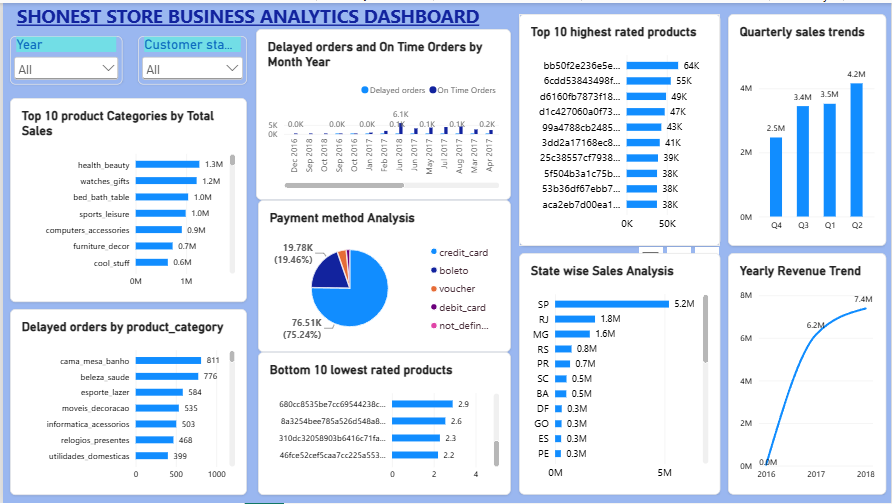

# 🛍️ ShopNest Store – Business Analytics Dashboard

### Transforming E-Commerce Data into Actionable Business Insights


---

## 📊 Dashboard Preview

<p align="center">
  
</p>

<p align="center">
  <b>Sales Performance | Delivery Analysis | Payment Insights | Product Ratings | Revenue Trends</b>
</p>

---

## 📌 Project Overview

The **ShopNest Store Business Analytics Dashboard** is an interactive Power BI project developed to analyze e-commerce business performance and generate meaningful insights from transactional data.

The project focuses on sales performance, customer purchasing behavior, delivery efficiency, payment preferences, product ratings, regional sales distribution, and revenue trends.

Interactive **Year** and **Customer State** slicers allow users to explore business performance across different time periods and geographical regions.

The objective is to transform raw e-commerce data into actionable insights that support informed business decisions.

---

## 🎯 Business Objectives

The dashboard addresses eight key business questions:

### 1️⃣ Top 10 Product Categories by Total Sales
- Identify the highest-performing product categories.
- Compare sales contributions across different categories.

### 2️⃣ Delayed Orders by Product Category
- Identify delayed deliveries across product categories.
- Compare actual delivery dates with estimated delivery dates.

### 3️⃣ Monthly Delayed vs On-Time Orders
- Compare monthly delivery performance.
- Identify periods with increased delivery delays.

### 4️⃣ Payment Method Analysis
- Analyze customer payment preferences.
- Identify the most frequently used payment methods.

### 5️⃣ Top 10 Highest-Rated & Bottom 10 Lowest-Rated Products
- Identify products receiving the highest and lowest ratings.
- Understand customer satisfaction patterns.

### 6️⃣ State-wise Sales Analysis
- Compare sales performance across customer states.
- Identify high-performing and low-performing regions.

### 7️⃣ Quarterly Sales Trends
- Analyze quarterly sales performance.
- Identify seasonal sales patterns.

### 8️⃣ Yearly Revenue Analysis
- Evaluate yearly revenue performance.
- Understand overall business growth trends.

---

## 📂 Dataset Overview

The project uses the ShopNest Store e-commerce dataset, containing multiple interconnected datasets.

The repository includes 10 CSV files:

- 👥 **Customers** – Customer details and geographical information.
- 📦 **Products** – Product information and categories.
- 🛒 **Orders** – Order dates and delivery information.
- 🧾 **Order Items** – Product quantities, prices, and freight values.
- 💳 **Order Payments** – Payment methods and payment values.
- ⭐ **Order Reviews** – Customer ratings and reviews.
- 🏪 **Sellers** – Seller information.
- 🌍 **Geolocation Part 01, 02 & 03** – Geographical location data.

The geolocation dataset is divided into three parts to make repository uploads manageable.

---

## ⚙️ Data Preparation & Modeling

Key activities performed during the project:

- Imported multiple CSV datasets into Power BI.
- Cleaned and transformed data using Power Query Editor.
- Handled missing values and checked data types.
- Established relationships between relevant datasets.
- Created calculated columns and DAX measures.
- Prepared sales, delivery, payment, rating, and revenue metrics.
- Developed interactive dashboard visuals and slicers.

---

## 🔍 Key Business Findings

### 📦 Product Category Performance
Health & Beauty recorded the highest category sales, followed by Watches & Gifts and Bed Bath Table.

### 🚚 Delivery Performance
Cama Mesa Banho and Beleza Saude recorded the highest delayed-order counts in the category comparison.

### 💳 Payment Preferences
Credit Card was the most frequently used payment method, representing approximately 75.24% of payment records.

### 🌍 Regional Sales Performance
São Paulo (SP) was the leading customer state, generating approximately 5.2M in sales, followed by Rio de Janeiro (RJ) and Minas Gerais (MG).

### 📈 Quarterly Sales Trends
Q2 recorded the highest quarterly sales in the dashboard, at approximately 4.2M.

### 💰 Yearly Revenue Trends
The dashboard shows revenue of approximately 6.2M in 2017 and 7.4M in 2018.

---

## 💡 Business Recommendations

- **Inventory Optimization:** Prioritize high-performing product categories to maintain product availability.
- **Delivery Improvement:** Investigate categories with higher delayed-order counts and improve logistics coordination.
- **Customer Experience:** Monitor low-rated products and identify opportunities to improve product quality.
- **Payment Optimization:** Continue supporting popular payment methods while improving customer payment convenience.
- **Regional Expansion:** Explore growth opportunities in states with comparatively lower sales.
- **Sales Planning:** Use quarterly and yearly trends to plan inventory, marketing campaigns, and business resources.

---

## 🛠️ Tools & Technologies

- **Microsoft Power BI** – Dashboard development and visualization.
- **Power Query Editor** – Data cleaning and transformation.
- **DAX** – Calculated measures and business metrics.
- **Data Modeling** – Relationships between multiple datasets.
- **CSV Datasets** – E-commerce transactional data.

---

## 📁 Project Structure

```text
ShopNest-Store-Business-Analytics/
│
├── Dataset/
│   ├── customers.csv
│   ├── products.csv
│   ├── orders.csv
│   ├── order_items.csv
│   ├── order_payments.csv
│   ├── order_reviews.csv
│   ├── sellers.csv
│   ├── geolocation_part_01.csv
│   ├── geolocation_part_02.csv
│   └── geolocation_part_03.csv
│
├── SHOPNEST_STORE_BUSINESS_ANALYTICAL_DASHBOARD.png
├── ShopNest Store Business Analytics Report.pbix
└── README.md
```

---

## 🚀 How to Explore the Project

1. Clone or download this repository.
2. Explore the CSV files available in the Dataset folder.
3. Download the Power BI report.
4. Open the `.pbix` file using Microsoft Power BI Desktop.
5. Explore the dashboard using Year and Customer State slicers.
6. Review the visualizations and business findings.

---

## 📑 Project Documentation

Detailed project documentation includes:

- Power BI Dashboard Report (PDF).
- Power BI Dashboard Report (Word).
- Eight business analysis questions.
- Dashboard visualizations and explanations.
- Business findings and recommendations.

---

## 👩‍💻 Author

**Devika Sutar**

Civil Engineering Graduate | Aspiring Data Analyst

Interested in Data Analytics, Business Intelligence, and transforming data into meaningful business insights.

---

<p align="center">
  ⭐ If you find this project useful, consider giving this repository a star!
</p>
